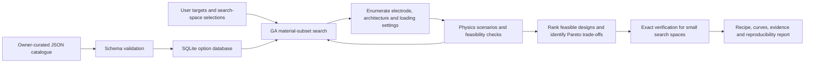

# SensorForge

**Property-driven evolutionary design of capacitive pressure sensors.**

The project owner maintains a database of material and architecture options. A user specifies desired performance and permitted combinations. SensorForge uses a genetic algorithm (GA), explicit physical calculations, and constraint checks to return candidate recipes and their trade-offs.

**Current status:** working local Streamlit application with a synthetic demonstration catalogue. There is no model-training step. Outputs are model-based screening hypotheses, not experimentally validated sensor recommendations.

## Start the app

Requires Python 3.11 or newer. Run these commands inside this repository:

```bash
python3 -m venv .venv
source .venv/bin/activate
python -m pip install -e '.[test,data]'
python scripts/manage_catalog.py data/catalog/demo_options.json --check
python scripts/manage_catalog.py data/catalog/demo_options.json
python -m streamlit run app.py
```

Open **http://localhost:8501**. Stop the app with **Ctrl+C**. Installing the demonstration catalogue replaces any existing operational catalogue, so use that command only during initial setup or an intentional demo reset. For an already configured checkout, just run `.venv/bin/python -m streamlit run app.py`.

See [setup and troubleshooting](docs/SETUP.md) for dependency locking, missing `venv` support, remote access, and verification commands.

## What goes in and what comes out?

| Actor | Supplies | Receives |
|---|---|---|
| Project owner | Catalogue properties, source references, compatibility rules, and valid operating limits | Validated SQLite database |
| App user | Pressure interval, minimum sensitivity and baseline capacitance, maximum nonlinearity and cost, geometry, and allowed options | Ranked feasible recipes, composition fractions, response scenarios, Pareto trade-offs, provenance, and exports |

Users can request exactly 2, 3, or 4 material constituents, a range, or all selected fillers. A material recipe has **one matrix plus its fillers**; the electrode pair and architecture are chosen separately. The first version searches discrete total filler loadings with equal volume shares among the selected fillers.

## Process



The GA searches; the physical evaluator estimates behavior. Neither infers missing measurements automatically. [The walkthrough](docs/WORKFLOW.md) explains every stage and the meaning of the outputs.

## Read the documentation

| Document | Purpose |
|---|---|
| [Project explanation](docs/PROJECT_OVERVIEW.md) | Problem, goals, scope, contributions, and language for presenting the project |
| [Setup](docs/SETUP.md) | Installation, running, tests, troubleshooting, and dependency snapshot |
| [User workflow](docs/WORKFLOW.md) | Inputs, combination sizes, algorithm controls, results, and exports |
| [Scientific methodology](docs/optimization_methodology.md) | Equations, assumptions, objectives, constraints, GA, Pareto analysis, and references |
| [Data preparation](docs/DATA_GUIDE.md) | Owner workflow, real-data requirements, units, and reference measurements |
| [Catalogue schema](data/catalog/README.md) | Exact required JSON fields and safe database import instructions |
| [Workbook assessment](docs/WORKBOOK_ASSESSMENT.md) | What the supplied 10-device workbook contains and what must be corrected or added |
| [Code architecture](docs/ARCHITECTURE.md) | Modules, data flow, persistence, and extension points |
| [Validation and limitations](docs/VALIDATION.md) | Software tests, model limitations, and experiments needed for scientific claims |
| [Demo and presentation](docs/DEMO.md) | A demonstration sequence, suggested explanation, and common questions |
| [Clean-copy handover](docs/HANDOVER.md) | What was retained, what was excluded, and development priorities |

## Data included

- `data/catalog/demo_options.json`: 12 explicitly synthetic entries—3 matrices, 5 insulating fillers, 2 electrode pairs, and 2 architectures.
- `data/raw/capacitive_pressure_sensor_10v1.xlsx`: the supplied 10-device literature catalogue, preserved unchanged as reference data. It is **not directly compatible with the optimizer**.
- `data/templates/pressure_measurements.csv`: an empty experimental collection template for future validation; the app does not import this table.
- `data/catalog/options.sqlite3`: generated operational database, excluded from Git. Install it with the owner CLI.

## Scientific boundaries

The current evaluator covers dilute insulating spherical fillers, constant-permittivity screening, and small-strain scalar compression scenarios with owner-supplied architecture factors. It excludes conductive-filler percolation, arbitrary pressure-dependent microstructure interactions, hysteresis, and large deformation. Scenario bands are not confidence intervals. Catalogue membership does not establish a new combination's experimental validity or novelty.

In particular, the project **does not currently learn from experimental response curves**. That wording belonged to an earlier project concept. This clean version documents the implemented training-free optimization system.

## Tests

```bash
python -m pytest -q
```

Tests exercise catalogue validation, analytical behavior, search constraints, reproducibility, exhaustive verification, Pareto results, and app workflows. These are software checks, not experimental validation. Test evidence for this checkout is recorded in [VALIDATION.md](docs/VALIDATION.md).
